<p align="center">
  
</p>

# OpenRTVE

Cliente libre de **RTVE Play** para Android y Android TV. Consulta y reproduce el
catálogo público de vídeo de RTVE (televisión, directos y archivo) a través de
sus interfaces HTTP, con una interfaz propia en Jetpack Compose. La radio y los
pódcasts quedan fuera a propósito: como en la app oficial, son cosa de RTVE Audio.

OpenRTVE no está afiliado a RTVE ni respaldado por ella. RTVE Play es una marca
de la Corporación de Radio y Televisión Española.

## Qué hace

- **Inicio, Buscar y Explorar**: barra inferior Material 3 en el móvil y
  panel de navegación lateral en la TV. Explorar agrupa el menú de RTVE
  (temáticas, canales, canales temáticos e infantil) sin repetir canales, y
  los canales temáticos se ven y se reproducen como directos.
- **Portadas** (principal y temáticas) con la presentación que dicta
  cada fila: carrusel destacado, pósters, cuadradas o apaisadas.
- **Fichas** organizadas según los tipos de la API de RTVE, sin deducir nada
  del título:
  - una **serie o programa** muestra temporadas y capítulos paginados en el
    orden de RTVE Play, sus extras (fragmentos y avances) y similares; el botón
    grande reproduce, continúa o pasa al siguiente capítulo según el historial;
  - un **contenedor** (un ciclo de cine, una colección de documentales) es un
    catálogo: cada película o documental abre su propia ficha;
  - un **vídeo o película** lleva sinopsis y ficha técnica (reparto, dirección,
    idioma, disponibilidad) y el enlace a su programa o colección ("Más en Cine
    de siempre"). Debajo, solo lo que no está en la cabecera: los capítulos de
    su temporada si es un episodio, o similares si es una película o un
    documental.

  En el móvil, las colecciones van en pestañas Material 3; en la TV, la ficha
  sigue la página de detalles de Google TV, con una fila por sección.
- **Buscador** con los filtros rápidos de la app oficial y resultados por
  bloque, paginados; **categorías** leídas de la configuración remota de RTVE.
- **Directos** con logo del canal, "● Directo" y progreso de la emisión;
  los programados muestran su horario. **Seguir viendo** local, sin cuenta:
  tocar continúa; desde su menú se abre la ficha o se quita (con deshacer).
- **Reproductor** Media3 apaisado a pantalla completa, con panel de ajustes (calidad, velocidad, audio,
  subtítulos), miniaturas al arrastrar, siguiente episodio con reproducción
  automática, ajuste de imagen, imagen en imagen, bloqueo, gestos (doble
  toque para saltar, deslizar para brillo y volumen), indicador de directo
  con ventana DVR y MediaSession.
- **DASH y HLS**, con Widevine para el contenido protegido.
- **Enlaces de RTVE**: `play.rtve.es/pr|v|d/{id}` y las URL web de
  `rtve.es/play/videos/...` abren la ficha o el directo; también desde
  "Compartir → OpenRTVE" en cualquier app.
- **Ajustes**: imagen en imagen, calidad máxima,
  reproducción automática, subtítulos por defecto y borrado de caché.
- **Rápida y ligera**: catálogo en caché con revalidación por ETag (la portada
  aparece al instante con la última copia), todas las imágenes pedidas al
  tamaño en que se pintan, caché de imágenes ajustada a la cuota que Android da
  a la app, un solo cliente HTTP/2 para catálogo, imágenes y vídeo, y Baseline
  Profile para un arranque en frío rápido. Allowlist estricta de hosts para la
  API y las imágenes.

Todo se deduce de los feeds públicos de RTVE: no hay listas compiladas de
canales, categorías ni filtros.

## Capturas

### Móvil

| Inicio | Explorar | Buscar |
| :---: | :---: | :---: |
| [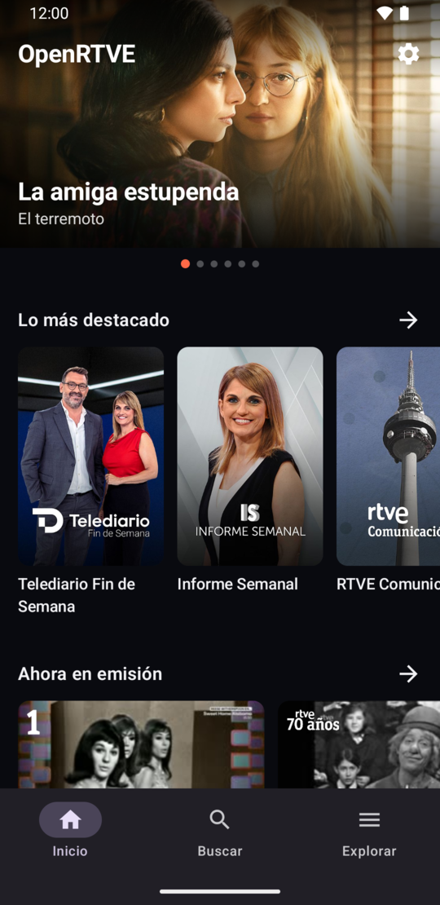](docs/assets/screenshots/phone-home.png) | [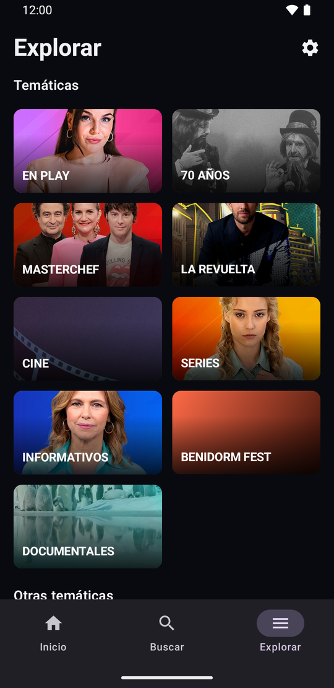](docs/assets/screenshots/phone-explore.png) | [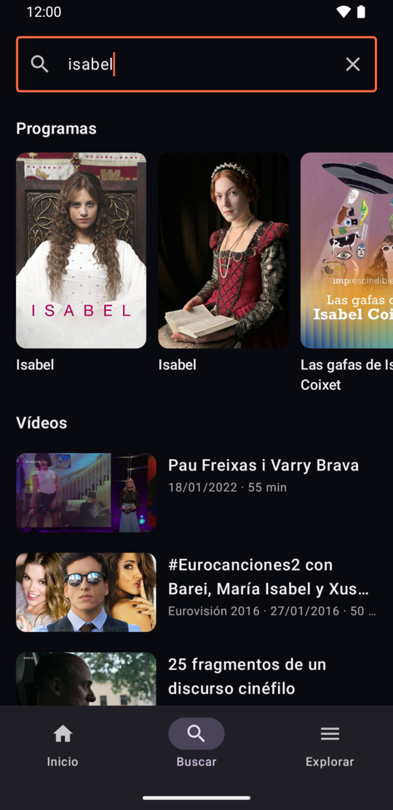](docs/assets/screenshots/phone-search-results.png) |

| Ficha de película | Ficha de programa |
| :---: | :---: |
| [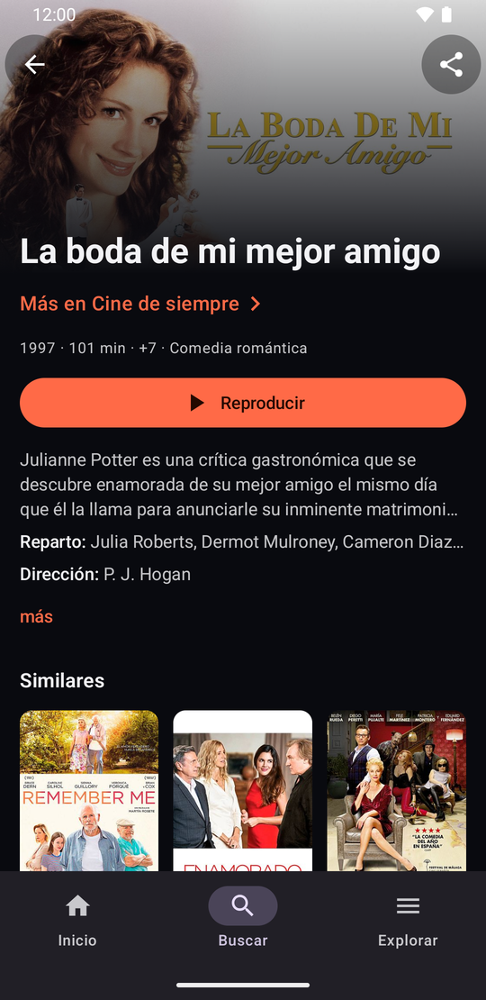](docs/assets/screenshots/phone-movie.png) | [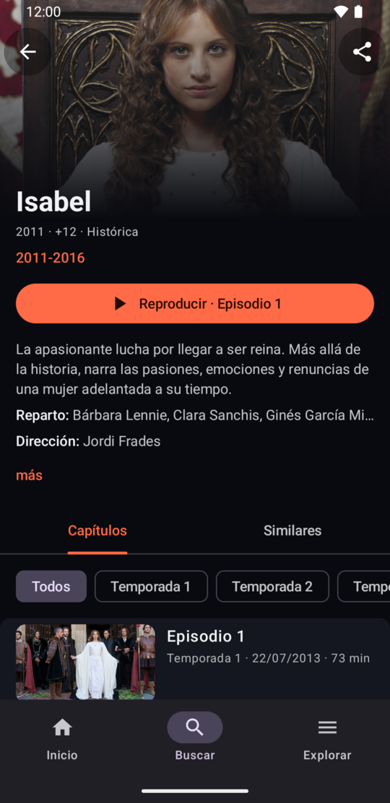](docs/assets/screenshots/phone-program.png) |

<p align="center">
  <a href="docs/assets/screenshots/phone-player.png">
    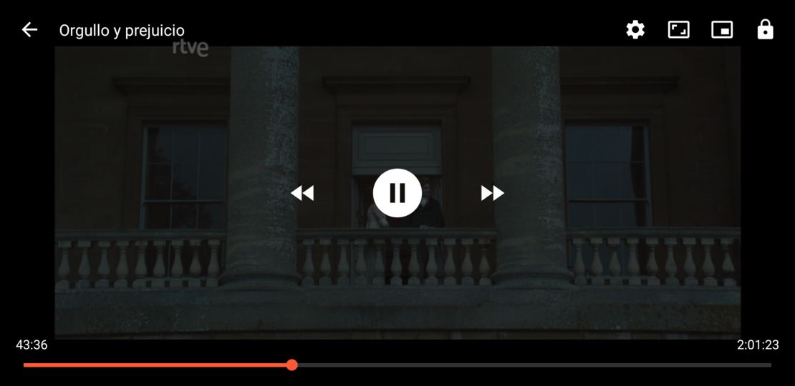
  </a>
  <br>
  <sub>Reproductor en horizontal</sub>
</p>

### Android TV

| Catálogo | Fichas y reproducción |
| :---: | :---: |
| [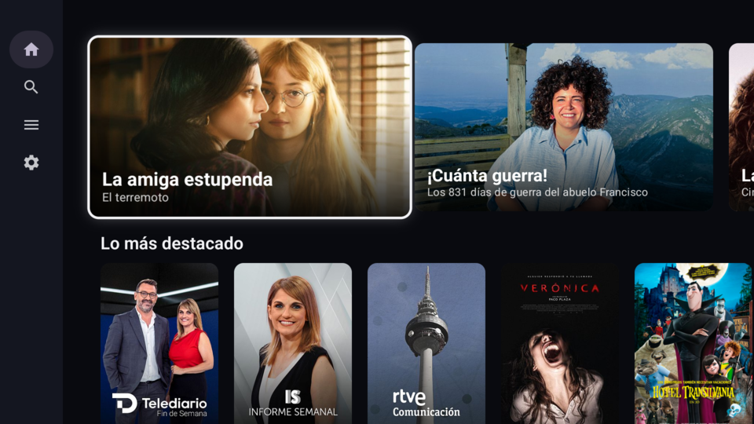](docs/assets/screenshots/tv-home.png)<br>Inicio | [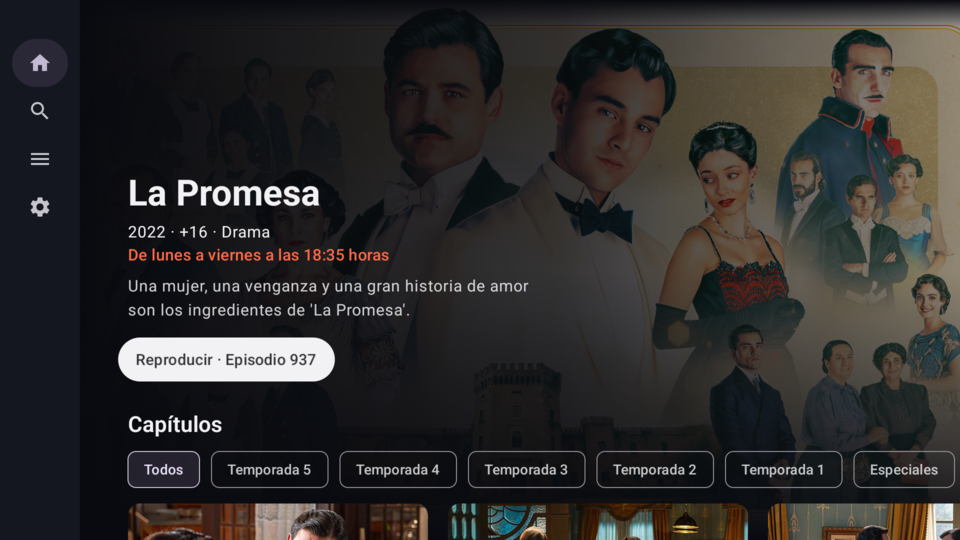](docs/assets/screenshots/tv-program.png)<br>Ficha de programa |
| [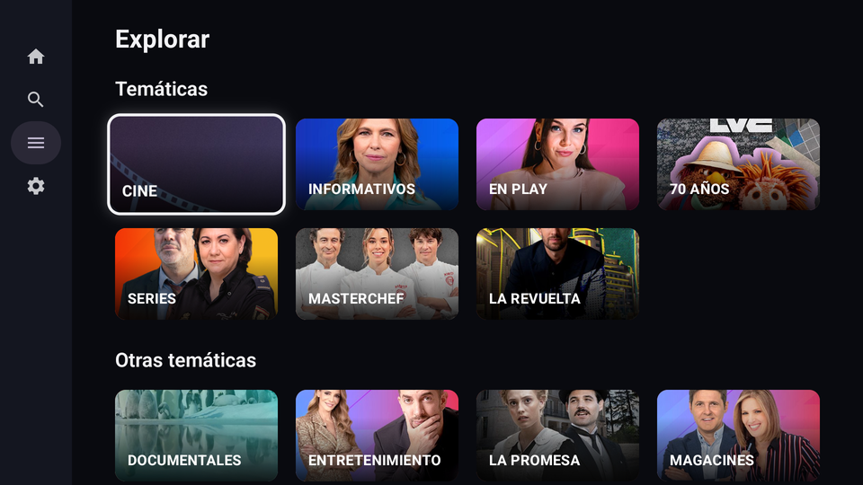](docs/assets/screenshots/tv-explore.png)<br>Explorar | [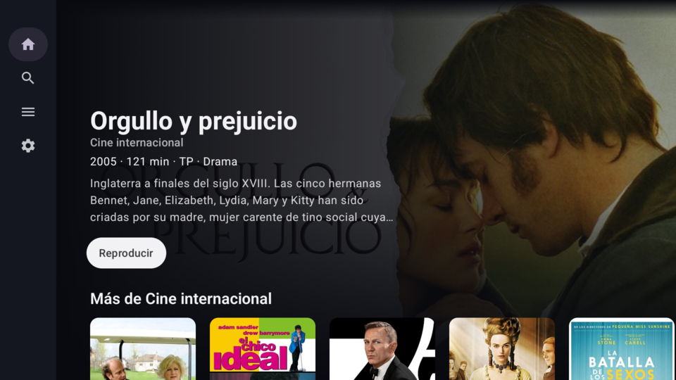](docs/assets/screenshots/tv-movie.png)<br>Ficha de película |
| [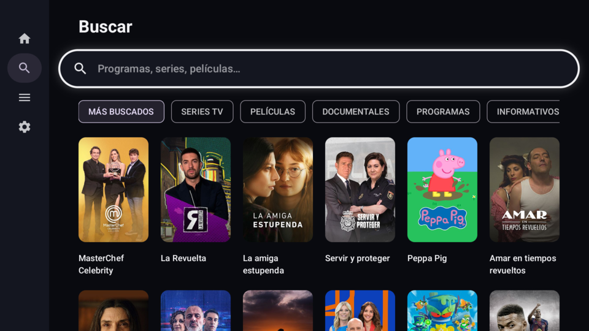](docs/assets/screenshots/tv-search.png)<br>Buscar | [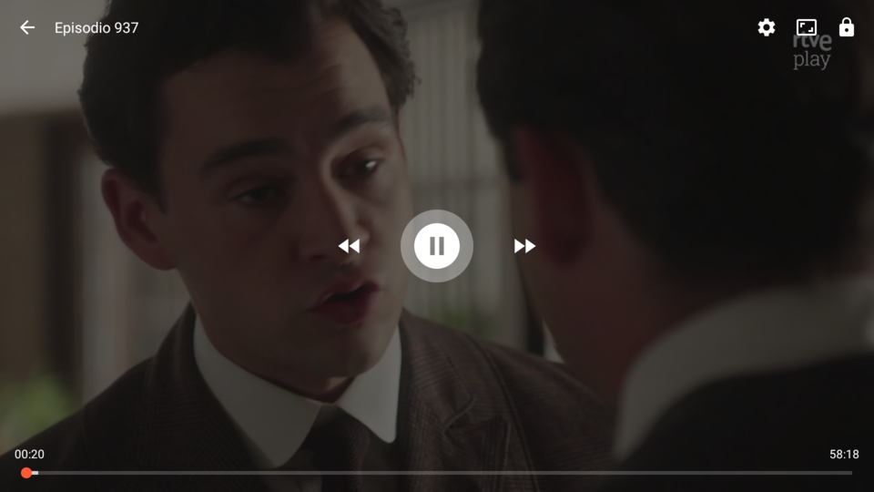](docs/assets/screenshots/tv-player.png)<br>Reproductor |

## Instalar

Descarga el APK de la sección *Releases* e instálalo en el móvil o en la TV
(en Android TV, por ejemplo con *Downloader* o `adb install`). La app detecta si
está en una TV y abre la interfaz de TV aunque el launcher lance la de móvil.

Enlaces: en Android 12 o superior, abrir un enlace `rtve.es` directamente en
OpenRTVE requiere activarlo en *Ajustes → Aplicaciones → OpenRTVE → Abrir por
defecto* (RTVE no publica la verificación de dominio para terceros). La vía
"Compartir → OpenRTVE" funciona siempre.

## Compilar

Con el SDK de Android instalado:

```bash
./gradlew assembleDebug          # APK de depuración
./gradlew testDebugUnitTest lintDebug
```

### Tests

- `./gradlew testDebugUnitTest`: tests JVM (parser de los feeds, repositorio y
  caché, cliente HTTPS, resolución de reproducción y de enlaces, historial y
  ViewModels). Corren sin emulador y son los que ejecuta la CI.
- `./gradlew connectedDebugAndroidTest`: tests de Compose de la portada, la
  búsqueda y las fichas de programa y de vídeo (en móvil y en TV, con el
  mando) contra un repositorio falso, sin red; también prueban la sesión de
  reproducción con ExoPlayer, un archivo local y tokens controlados. Necesitan
  un emulador o dispositivo conectado (`ANDROID_SERIAL=emulator-5554` si hay varios); al
  terminar, Gradle desinstala la app de ese dispositivo.

Los fakes y los contratos de recuperación de red, caché y búsqueda compartidos
por ambas capas están en `app/src/sharedTest`.

Sin SDK en el host, con Docker:

```bash
docker build --output type=local,dest=build/docker .
```

El APK queda en `build/docker/openrtve-debug.apk`. La imagen fija Android
Command-line Tools por versión y SHA-256, instala API 37 y Build Tools 36, y
ejecuta tests, lint y `assembleDebug`.

### Release

```bash
./gradlew assembleRelease
```

Si existe `keystore.properties` en la raíz (`storeFile`, `storePassword`,
`keyAlias`, `keyPassword`) el APK se firma con esa clave; si no, con la de
depuración para que siga siendo instalable. Keystore y propiedades están en
`.gitignore` y `.dockerignore`: guarda una copia, sin esa clave no se pueden
publicar actualizaciones sobre la app instalada.

### Baseline Profile

El release incluye un Baseline Profile (`app/src/release/generated/baselineProfiles/`)
que ART usa al instalar para precompilar los caminos calientes: arranque en
frío y primeros scrolls más rápidos en cualquier dispositivo. Se regenera con
un emulador o móvil conectado (imagen `google_apis` o `aosp`, con `adb root`):

```bash
./gradlew :app:generateBaselineProfile
```

## Diseño del código

Un único módulo `app`; los paquetes separan responsabilidades que ya tienen
comportamiento:

- `data`: cliente HTTPS sobre OkHttp, parser JSON tolerante, caché y repositorio;
- `domain`: modelos, tipos editoriales de RTVE (`MediaClassification`), allowlist
  de hosts y política de reproducción;
- `ui`: navegación (una pila por pestaña y Ajustes global), un ViewModel por
  pantalla, el estado que comparten móvil y TV (secciones de las fichas,
  paginación, textos);
- `ui/mobile` y `ui/tv`: los dos árboles de interfaz, que comparten todo lo demás;
- `playback`: ExoPlayer, `MediaSessionService`, controles y gestos.

No se añadirán módulos Gradle, base de datos ni framework de inyección hasta
que una función real los justifique. Las decisiones se amplían en
[docs/architecture.md](docs/architecture.md).

## Documentación de interoperabilidad

- [Contratos HTTP y modelo canónico](docs/api-contracts.md)
- [Matriz de paridad y criterios de aceptación](docs/feature-parity.md)
- [Mapa de RTVE Play 8.8.1](docs/reverse-engineering-rtve-play.md)
- [Análisis del resolver `com.rtve.ztnr`](docs/reverse-engineering-ztnr.md)

Estos documentos describen contratos HTTP públicos y comportamiento observado.
El repositorio no incorpora código decompilado, material gráfico de la
aplicación original, credenciales, claves de firma ni licencias DRM.

## Agradecimientos

El diseño de la portada, las fichas y el reproductor se inspira en
[Findroid](https://github.com/jarnedemeulemeester/findroid); el código es
propio.

## Licencia

[GPL-3.0](LICENSE).
